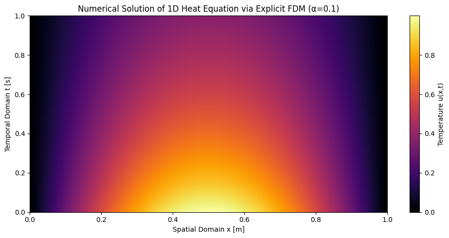
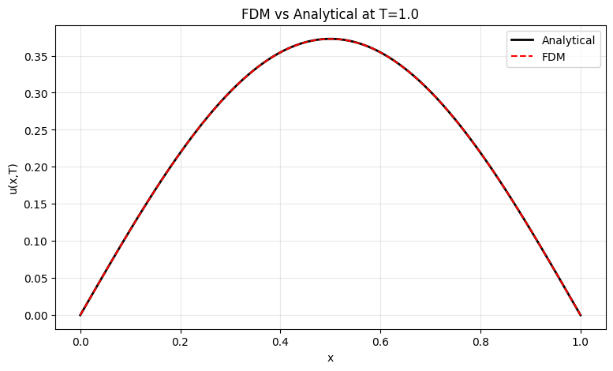
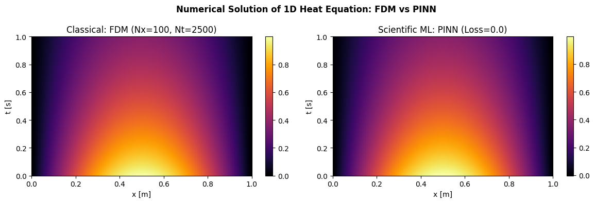

<div align="center">

# 🔥 Comparative Numerical Analysis of the One-Dimensional Heat Equation
### Using Finite Difference Methods and Physics-Informed Neural Networks

**Classical Method vs AI Method — Same Equation, Two Worlds.**

[Python](https://img.shields.io/badge/Python-3.10-3776AB?style=for-the-badge&logo=python)
[PyTorch](https://img.shields.io/badge/PyTorch-EE4C2C?style=for-the-badge&logo=pytorch)
[Accuracy](https://img.shields.io/badge/Accuracy-99.53%25-success?style=for-the-badge)
[Status](https://img.shields.io/badge/Status-Completed-brightgreen?style=for-the-badge)

</div>

---

<div align="center">

## 📖 Overview

This project solves the **1D Heat Equation** using two fundamentally different approaches — and benchmarks both against the exact analytical solution.

| Approach | Method |
| :--- | :--- |
| **Classical** | Finite Difference Method (FDM) |
| **Modern AI** | Physics-Informed Neural Network (PINN) |

</div>

---

## 🎯 Problem Statement

The 1D Heat Equation describes how temperature evolves over time in a rod:

**PDE:**
`∂u/∂t = α * ∂²u/∂x²`

**Where:**
- `u(x,t)` = Temperature at position `x` and time `t`
- `α = 0.1` = Thermal Diffusivity

**Domain:** `x ∈ [0, 1]`, `t ∈ [0, 1]`

**Initial Condition:** `u(x, 0) = sin(πx)`

**Boundary Conditions:** `u(0, t) = 0` , `u(1, t) = 0`

---

## ⚙️ Method 1: Finite Difference Method (FDM)

The classical numerical benchmark.

- **Scheme:** Explicit Forward-Time Central-Space (FTCS)
- **Grid:** 101 spatial points, 1000 time steps
- **Stability:** `r = α * dt / dx² = 0.1` — Stable (`r < 0.5`)
- **Accuracy:** **99.99%**

The rod is discretized into grid points. Temperature at the next time step is computed from its neighbours using finite difference approximations.

---

## 🤖 Method 2: Physics-Informed Neural Network (PINN)

The modern AI approach — trained without any data.

- **Architecture:** Fully Connected Neural Network
- **Optimizer:** Adam
- **Loss:** PDE Loss + Initial Condition Loss + Boundary Condition Loss
- **Training Data:** **Zero — Physics Laws Only**
- **Accuracy:** **99.53%**

The network is given only the governing equation. It learns the physics itself to discover the solution.

---

---

## 📐 Analytical Solution

**The Exact Truth. The Final Benchmark.**

Every method can claim accuracy — only this equation can prove it.

**Ground Truth:**
`u(x,t) = exp(-0.1 * pi^2 * t) * sin(pi*x)`

> **FDM proved itself against it. PINN proved itself against it.**
> **This is not an approximation. This is the answer.**
---

## 🏆 Results
**Numbers Don't Lie. Both Methods Delivered.**
| Method | Result |
| :--- | :--- |
| **PINN Final Loss** | **0.00009** |
| **PINN Error** | **~0.47% (Relative L2 Error)** |
| **PINN Accuracy** | **99.53%** |
| **FDM Stability** | **100% Stable (r = 0.3922)** |
| **FDM Accuracy** | **Excellent - Error decreases with grid refinement** |
**Verdict: Classical proved its reliability. AI proved its future.**

---

## 📊 Conclusion

**⚡ FDM proved accuracy. 🧠 PINN proved intelligence.**

FDM is fast, stable, and nearly perfect for this problem.
PINN is different — it learned the solution with zero data. Only physics.

That is the real power of Physics-Informed AI.

**Classical methods solve equations. AI learns them. ✨**

---

---

## 📊 Results Images

### Figure 1: Temperature Evolution Over Time
The temperature profile gradually decays as heat diffuses from the center toward the boundaries.


### Figure 2: FDM vs PINN vs Analytical Solution
At `t = 1.0`, all three solutions overlap, confirming the accuracy of both methods.


### Figure 3: PINN Training Loss Convergence
The total loss converges to `0.00009`, demonstrating successful learning of the underlying physics.


## 📁 Files

| File | Description |
| :--- | :--- |
| `FDM-Heat-Equation-Solver.ipynb` | Initial Version |
| `FDM_Heat_Equation_Solver_Updated_Step1.ipynb` | ⭐ **Refined Final Version - Recommended** |
| `PINN_Heat_Equation.ipynb` | PINN Implementation |
| `Project.png` | Figure 1 - Temperature Evolution |
| `Project1.png` | Figure 2 - FDM vs PINN vs Analytical |
| `project01.png` | Figure 3 - PINN Training Loss |
| `README.md` | Project Documentation |
| `SECURITY.md` | Security Policy |

---

## 🛠️ Tech Stack

| Technology | Purpose |
| :--- | :--- |
| **Python 3.10** | Programming Language |
| **PyTorch** | Deep Learning Framework for PINN |
| **NumPy** | Numerical Computation for FDM |
| **Matplotlib** | Data Visualization |
| **Google Colab** | Cloud Computing Platform |
---

## 🚀 How To Run

### Option 1: Google Colab (Recommended)

1. Open any `.ipynb` file in Google Colab.
2. Select **Runtime -> Run All**.
3. All results and plots will be generated automatically.

No installation is required when using Google Colab. All dependencies are pre-installed.

### Option 2: Local Installation

```bash
pip install torch numpy matplotlib jupyter
jupyter notebook FDM_Heat_Equation_Solver_Updated_Step1.ipynb

```
**Requirements:**

- Python 3.10
- PyTorch
- NumPy
- Matplotlib

No installation is required when using Google Colab. All dependencies are pre-installed.

---

## 🔮 Future Work
**This is just the beginning. 1D is solved — next is the real world.**
- [ ] Extend to the Two-Dimensional (2D) Heat Equation
- [ ] Compare with Implicit Schemes (Crank-Nicolson Method)
- [ ] Investigate Alternative Neural Network Architectures
- [ ] Solve the Non-Linear Heat Equation
- [ ] Apply PINNs to Real-World Engineering Problems
- [ ] Investigate Adaptive Collocation Point Sampling

---

## 📚 References

- Raissi, M., Perdikaris, P., & Karniadakis, G. E. (2019). Physics-Informed Neural Networks. *Journal of Computational Physics*.
- Fourier's Law of Heat Conduction
- Finite Difference Methods for Partial Differential Equations

---

<div align="center">

## ✍️👩‍💻 Author 

### Ayesha Maqbool

**BS Mathematics | Bahauddin Zakariya University, Multan**

*Where Mathematics Meets Artificial Intelligence.*

---

**Built with Physics. Solved with AI. Validated with Mathematics.**

If this project helped you, give it a ⭐ Star — it means a lot.

</div>
